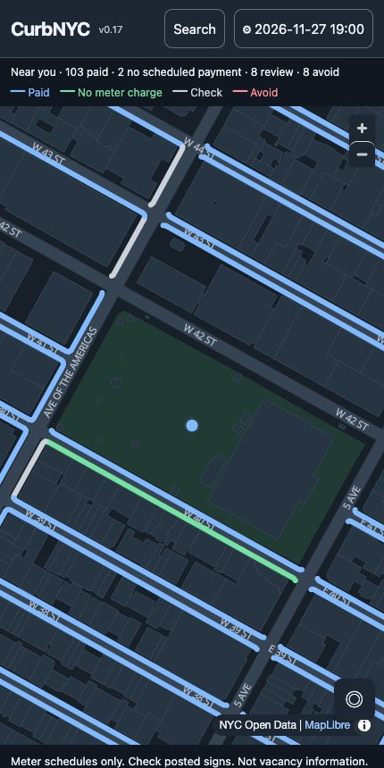

# CurbNYC

CurbNYC is a free, open-source NYC parking map. It shows official NYC meter blockfaces near the center of the map, with passenger-meter hours, published rates, and commercial restrictions when the meter schedule supports them.

[Open the map](https://chrisgaun.github.io/curbnyc/)



## Use the map

- Start near your location or browse from Bryant Park. Use **Search** to find an NYC address or place. The app sends search text to NYC Planning when you submit it.
- Tap a colored curb for the published meter schedule, rate estimate when available, and commercial restrictions. Use **Settings** to plan a stay, set the search radius, or select System, Light, or Dark.
- Expand **Data and nearby meters** for the snapshot date, nearby list, and planned street-cleaning suspensions. Check NYC311 for current suspension status, including emergency updates.

Check posted signs and the curb. A blockface with no scheduled meter payment can still have other restrictions. Coverage is limited to official meter records. The app does not show vacancy, validate individual street-cleaning rules, or map hydrant, bus stop, and temporary exclusions. The non-metered sign pilot remains offline.

After one online visit, an offline launch can show a retry screen. Meter schedules and maps still require a connection.

## Develop locally

Run `python3 -m http.server 8000` from the repository root and open `http://localhost:8000`. Browser geolocation requires HTTPS or localhost. Run `npm test` for app tests and `python3 -m unittest scripts.test_sign_blockfaces` for the offline sign pilot.

The active entry point is `index.html`. It uses MapLibre GL JS and official NYC Open Data for [meter blockfaces](https://data.cityofnewyork.us/d/e7yp-wx55), [streets](https://data.cityofnewyork.us/d/inkn-q76z), [buildings](https://data.cityofnewyork.us/d/5zhs-2jue), and [parks](https://data.cityofnewyork.us/d/y6ja-fw4f). Background requests include the map viewport. The code is MIT-licensed. Source data and third-party assets have their own terms.

The [Alpha 1 release](https://github.com/chrisgaun/curbnyc/releases/tag/v0.1.0-alpha.1) records the approved v0.12 build. `meters-baseline.html` is the independent meter-layer reference.

## Meter schedule and snapshot coverage

The calculator supports the weekly schedules, split windows, overnight intervals, and Mon–Thu/Friday rates covered by the checked-in fixtures. It confirms payment status separately from the estimated charge. Estimates cover complete published billing units during a fully paid stay, or zero scheduled payment during a fully unpaid stay. Mixed windows, unsupported rate text, atypical stay limits, seasonal schedules, and daylight-saving transition days can require a meter or posted-sign check.

The regression fixtures preserve five NYC Open Data records, including West 41 Street (104933), Bedford Avenue in Williamsburg (301265), and a 30-minute Jackson Heights meter (466707). These records were compared with the live data API. The published DOT rates provide zone-level corroboration. Field signs can differ and were not independently checked.

The monthly Actions refresh keeps the previous published snapshot if the response is incomplete or validation fails. **Data and nearby meters** shows the source, fetch date, and abbreviated content digest. A fetch date records when CurbNYC retrieved the data. Snapshots older than 45 days show an age warning. A failed refresh of an open map keeps its previous lines visible. The deployed app reads the snapshot directly from GitHub main so a data update can be picked up without a Pages build.

On browsers with gzip streaming support, the active map first tries the lossless compact snapshot generated alongside the canonical JSON. The compact format preserves double-precision line coordinates, feature order, and meter schedule strings. If it is unavailable or invalid, the app uses the canonical JSON and then paginated NYC Open Data. The first successful refresh after rollout publishes the compact file. For a local preview, run `python3 scripts/pack_meters.py data/meters.json` before starting the server. The generated file is managed by the refresh workflow; keep the canonical JSON in place for older browsers and the existing meter views.

## Project notes

- [Non-metered sign pilot](docs/non-metered-sign-pilot.md)
- [Street-cleaning calendar and curb exclusions](docs/asp-and-curb-exclusions.md)
- [Search and local preferences](docs/mobile-search.md)
- [Android release preflight](docs/android-preflight.md)

## Midtown vector tile pilot

`scripts/prototype_basemap_tiles.cjs` generates static XYZ Mapbox Vector Tiles for zooms 14–16 around Bryant Park and Times Square. Use Node.js 22.12+ and install the pilot tools outside the checkout:

```sh
npm install --prefix /tmp/curb-tile-tools geojson-vt@5.0.4 vt-pbf@3.1.3
NODE_PATH=/tmp/curb-tile-tools/node_modules node scripts/prototype_basemap_tiles.cjs INPUT_DIR OUTPUT_DIR
```

Supply `streets.geojson`, `buildings.geojson`, and `parks.geojson` from the datasets above, covering west −73.995, south 40.744, east −73.974, and north 40.764. Serve the output as `{z}/{x}/{y}.pbf` with NYC Open Data attribution. The PBF source layers are named `streets`, `buildings`, and `parks`. The street label field is `st_label`. The app continues to use the viewport loader while the pilot is evaluated.
